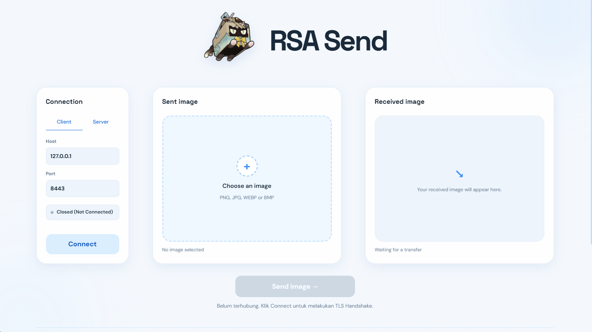

# RSA Send
<p align="center">
  
</p>

RSA Send is a application for sending images over an encrypted TCP connection using TLS layer architeture. Using an implementasion of RSA-KEM Key Exchange for the better solution for RSA Key transport.

## Dependencies
- `cryptography>=50.0.2`
- `numpy>=2.5.4`
- `pillow>=12.3.0`
- `pywebview>=5.4`


## Installation
### Requirements
- [git](https://git-scm.com/)
- Python >= 3.12
- [uv](https://docs.astral.sh/uv/)
- A desktop environment that supports `pywebview`

1. Install `uv` if it is not already available:
	- Windows (PowerShell)
	```bash
	powershell -c "iwr https://astral.sh/uv/install.ps1 | iex"
	```
	- Mac/Linux
	```bash
	curl -LsSf https://astral.sh/uv/install.sh | sh
	```
2. Clone the repository:
	```
	git clone <URL_REPOSITORY_GITHUB_KELOMPOK>
	cd RSA_send
	```

3. Install dependencies:
	```
	uv sync
	```

4. Launch the application:
	```
	uv run rsa-send
	```

## Usage

Run one instance as the Server and another as the Client. Use the same host and port
for both instances. For local testing, use `127.0.0.1:8443`.

### Server
1. Select **Server** mode.
2. Enter the host and port to use.
3. Click **Start server** and wait for the `Listening` status.

### Client
1. Select **Client** mode.
2. Enter the Server host and port.
3. Click **Connect** to start the handshake.
4. After the connection is established, select an image using **Choose an image**.
5. Click **Send image**.

The Server receives the encrypted payload, decrypts it using the session traffic key,
and reconstructs the raw bytes as an image in the **Received image** panel.

## Architecture Overview

<p align="center">
	
</p>

The session key is never transmitted directly. The Client encapsulates an RSA-KEM
ciphertext using the Server public key. The Server decapsulates it with its CRT private
key, and both sides derive the same traffic key using HKDF and both random values as salt.

## Screenshots

### Main Interface
<p align="center">
	
</p>

### Client: Connection and Handshake
<p align="center">
	
</p>

### Client: Sending an Image
<p align="center">
	
</p>

### Server: Opening a Connection
<p align="center">
	
</p>

### Server: Receiving an Image
<p align="center">
	
</p>

## TODO

### Modular Math (Pandu & Haidar)
- [x] `miller_rabin(n, k)` — Parameters: `n`, `k`; Expected Output: `bool` indicating whether `n` is probably prime.
- [x] `mod_pow(base, exp, mod)` — Parameters: `base`, `exp`, `mod`; Expected Output: `int` modular exponentiation result.
- [x] `mod_invers(a, b)` — Parameters: `a`, `b`; Expected Output: `int` modular inverse of `a` modulo `b`.
- [x] `generate_prime(bits)` — Parameters: `bits`; Expected Output: `int` prime number with the requested bit length.
- [x] `ext_gcd(a, b)` — Parameters: `a`, `b`; Expected Output: tuple `(gcd, x, y)` satisfying `a*x + b*y = gcd`.
- [x] `crt_reconstruct(m_p, m_q, p, q, q_inv)` — Parameters: `m_p`, `m_q`, `p`, `q`, `q_inv`; Expected Output: `int` CRT reconstruction result.

### Cryptography (Azzam & Ikhsan)
- [x] `hkdf_extract(salt, ikm, hash_alg)` — Parameters: `salt`, `ikm`, `hash_alg`; Expected Output: `bytes` pseudorandom key. (Ikhsan)
- [x] `hkdf_expand(prk, info, length, hash_alg)` — Parameters: `prk`, `info`, `length`, `hash_alg`; Expected Output: `bytes` traffic key with the requested length. (Ikhsan)
- [x] `rsa_generate_key_crt(bits)` — Parameters: `bits`; Expected Output: tuple `(public_key, private_key_crt)`. (Azzam)
- [x] `rsa_kem_encapsulate(public_key, key_len, salt)` — Parameters: `public_key`, `key_len`, `salt`; Expected Output: tuple `(ciphertext, traffic_key)`. (Azzam)
- [x] `rsa_kem_decapsulate_crt(c_input, private_key_crt, key_len, salt)` — Parameters: `c_input`, `private_key_crt`, `key_len`, `salt`; Expected Output: `bytes` traffic key. (Azzam)
- [x] `sign_certificate(server_pub_key, ca_priv_key)` — Parameters: `server_pub_key`, `ca_priv_key`; Expected Output: `int` certificate signature. (Ikhsan)
- [x] `verify_certificate(server_pub_key, signature, ca_pub_key)` — Parameters: `server_pub_key`, `signature`, `ca_pub_key`; Expected Output: `bool` certificate verification result. (Ikhsan)

### Image Processing (Ikhsan)
- [x] `ImageProcessor(image_path)` — Parameters: `image_path`; Expected Output: image processor object.
- [x] `ImageProcessor.to_bytes()` — Parameters: none; Expected Output: tuple `(raw_bytes, shape, dtype)`.
- [x] `ImageProcessor.to_image(raw_bytes, shape, dtype)` — Parameters: `raw_bytes`, `shape`, `dtype`; Expected Output: `PIL.Image` object.
- [x] `chunk(data, chunk_size)` — Parameters: `data`, `chunk_size`; Expected Output: `list[bytes]` data chunks.
- [x] `chunks_join(chunks)` — Parameters: `chunks`; Expected Output: combined `bytes` data.

### Network and TLS Record Layer (Ikhsan)
- [x] `send_exact(sock, data)` — Parameters: `sock`, `data`; Expected Output: all data sent through the socket.
- [x] `recv_exact(sock, length)` — Parameters: `sock`, `length`; Expected Output: `bytes` with the requested length.
- [x] `unpack_image_payload(payload)` — Parameters: `payload`; Expected Output: tuple `(raw_bytes, shape, dtype)`.
- [x] `TLSRecordLayer.send_record(sock, raw_data)` — Parameters: `sock`, `raw_data`; Expected Output: encrypted record sent.
- [x] `TLSRecordLayer.recv_record(sock)` — Parameters: `sock`; Expected Output: decrypted `bytes` for one record.
- [x] `TLSRecordLayer.send_message(sock, raw_data)` — Parameters: `sock`, `raw_data`; Expected Output: framed and encrypted message sent.
- [x] `TLSRecordLayer.recv_message(sock)` — Parameters: `sock`; Expected Output: complete decrypted message as `bytes`.
- [x] `TLSClientSession.perform_handshake()` — Parameters: none; Expected Output: `list[dict]` handshake logs and an active TLS session.
- [x] `TLSClientSession.send_image(image_bytes, shape, dtype)` — Parameters: `image_bytes`, `shape`, `dtype`; Expected Output: `list[dict]` image-transfer logs.
- [x] `TLSServerNetwork.start_listening()` — Parameters: none; Expected Output: server socket listening for connections.
- [x] `TLSServerNetwork.accept_client_and_handshake(log_fn)` — Parameters: `log_fn`; Expected Output: tuple `(socket, record_layer, client_address)`.

### Application Bridge and User Interface (Ikhsan, Azzam, Pandu, Haidar)
- [x] Design UI UX (Azzam, Pandu, Haidar)
- [x] Implement Design Using HTML and CSS (Azzam)
- [x] `Bridge.select_image()` — Parameters: none; Expected Output: `dict` containing image status, metadata, and preview. (Ikhsan)
- [x] `Bridge.connect_client(host, port)` — Parameters: `host`, `port`; Expected Output: `dict` containing connection status and handshake logs. (Ikhsan)
- [x] `Bridge.disconnect_client()` — Parameters: none; Expected Output: `dict` containing disconnection status. (Ikhsan)
- [x] `Bridge.send_image(image_path)` — Parameters: `image_path`; Expected Output: `dict` containing transfer status and metadata. (Ikhsan)
- [x] `Bridge.start_server(host, port)` — Parameters: `host`, `port`; Expected Output: `dict` containing server status. (Ikhsan)
- [x] `Bridge.stop_server()` — Parameters: none; Expected Output: `dict` containing stopped-server status. (Ikhsan)
- [x] `Bridge.get_server_status(last_log_index)` — Parameters: `last_log_index`; Expected Output: `dict` containing server status, new logs, and image metadata. (Ikhsan)


## Contribution Guidelines
Use a separate branch for each feature or fix. Changes to the main branch must go
through a pull request.

Use Conventional Commits:
| Type | Purpose | Example |
| :--- | :--- | :--- |
| `feat` | Add a new feature. | `feat(auth): add google login integration` |
| `fix` | Fix a bug or technical issue. | `fix(api): resolve memory leak on user fetch` |
| `docs` | Update documentation or Markdown files. | `docs: update setup instructions in README` |
| `style` | Change formatting without changing behavior. | `style: run prettier formatter on all files` |
| `refactor` | Restructure code without changing behavior. | `refactor: simplify user validation logic` |
| `perf` | Improve performance. | `perf: optimize database query indexing` |
| `test` | Add or update tests. | `test: add edge case tests for checkout flow` |
| `build` | Change build systems, dependencies, or tooling. | `build: upgrade react version to 19` |
| `chore` | Perform routine maintenance. | `chore: release version 1.2.0` |

## AI Usage and Fair Use
AI tools were used **only as assistants during frontend development**, The project architecture, backend,
cryptographic implementation, integration, testing, and final review were handled
and verified by the development team.

## Contributors
Muhammad Azzam Al Farizi - L0125023
Ikhsan Raditya Purnawarman - L0125103
Pandu Jatu Pradityo - L0125111
Haidar Ihda Chusnayain - L0125082


## License
This project is intended for development and educational purposes.